# Sailfish OS on the TicWatch C2

Sailfish OS running on the Mobvoi **TicWatch C2** (codename *skipjack*,
MSM8909W), with a round watch home screen and a phone companion app.

```
companion/   Watch Link: Android companion app (web UI / PWA + native service)
watch/       the Sailfish OS port: hardware adaptation, round shell, services
```

## Screenshots

Taken on the watch (360×360, round). Sample notifications and weather city; nearby network and device names are pixelated.

| | | |
|:-:|:-:|:-:|
| 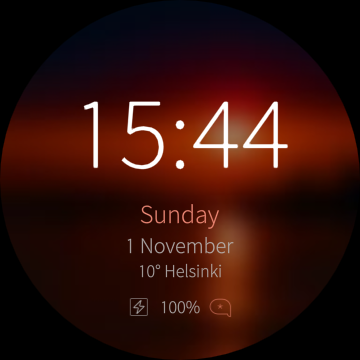<br>Watch face | 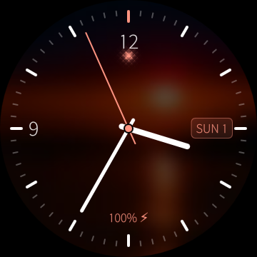<br>Analog face | 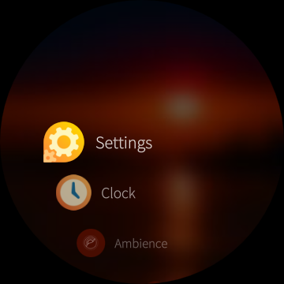<br>App list |
| 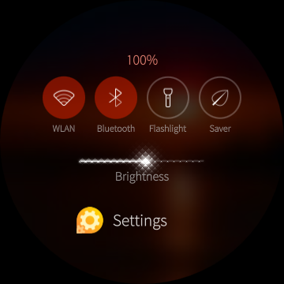<br>Quick settings | 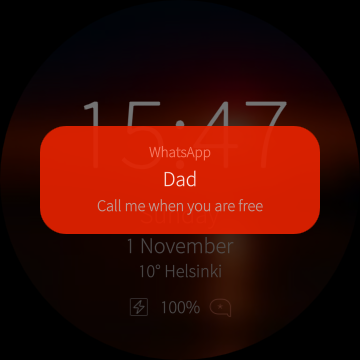<br>Notification from the phone | 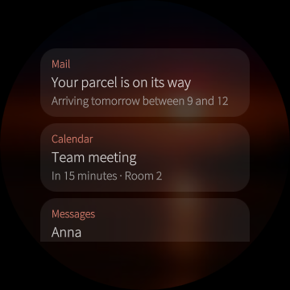<br>Notifications |
| 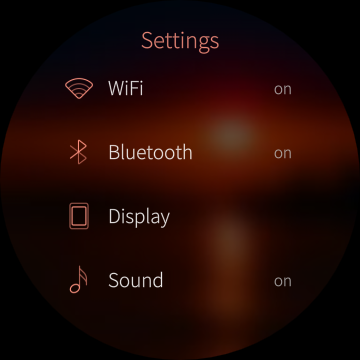<br>Settings | 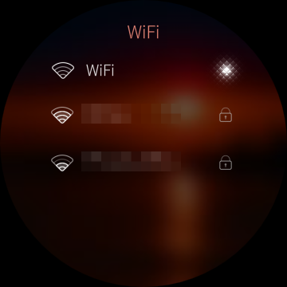<br>WiFi | 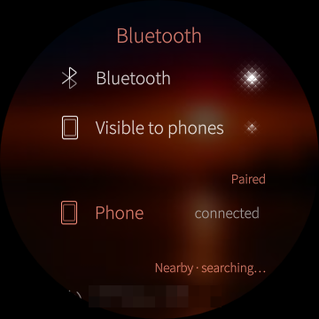<br>Bluetooth |
| 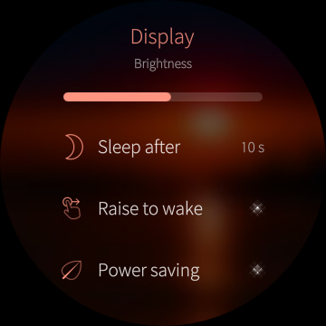<br>Display | 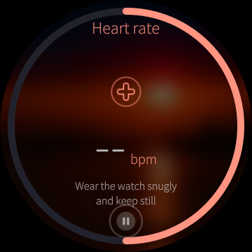<br>Heart rate | 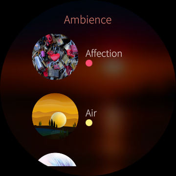<br>Ambiences |
| 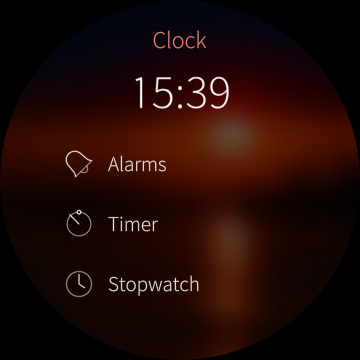<br>Clock | 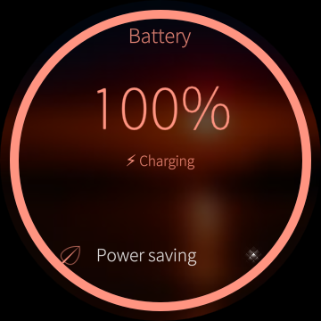<br>Battery |  |

## What works

| Area | Status |
|---|---|
| Display, touch, GPU | ✅ hwcomposer, 360×360 round |
| Round home screen | ✅ watch face, launcher, quick settings, notifications, watch apps |
| WiFi | ✅ wcnss/prima, password entry with an on-watch T9 keypad |
| Bluetooth | ✅ pairing, devices, internet from a phone (Bluetooth tethering) |
| Phone sync | ✅ notifications, weather, music, time, battery (AsteroidOS protocol) |
| Sensors | ✅ accelerometer, gyroscope, step counter, heart rate, wrist tilt |
| Raise to wake | ✅ wrist-tilt gesture |
| Heart rate | ✅ spot measurement app |
| Clock | ✅ RTC offset kept across reboots, network/phone time |
| Vibration, brightness, battery | ✅ |
| Buttons | ✅ power (display), side button (home/back) |
| GPS, NFC | ❌ not supported (not on AsteroidOS either) |
| Audio | — the C2 has no speaker |

See [watch/README.md](watch/README.md) for building and flashing, and
[companion/README.md](companion/README.md) for the app.

## Licenses

- `watch/watch-btsyncd`: GPLv3 (AsteroidOS asteroid-btsyncd, see its LICENSE).
- `watch/lipstick-watch-shell`, `watch/skipjack-sensorhelper`: LGPL-2.1 (SPDX headers).
- Proprietary Android/vendor binaries are **not** included (see watch/README.md).
